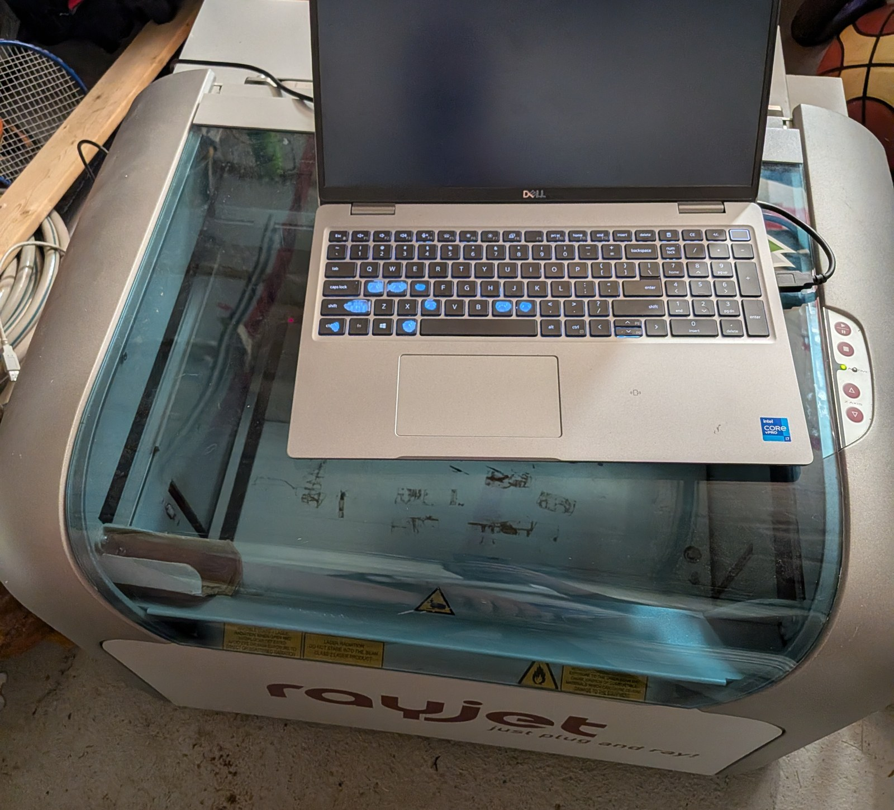
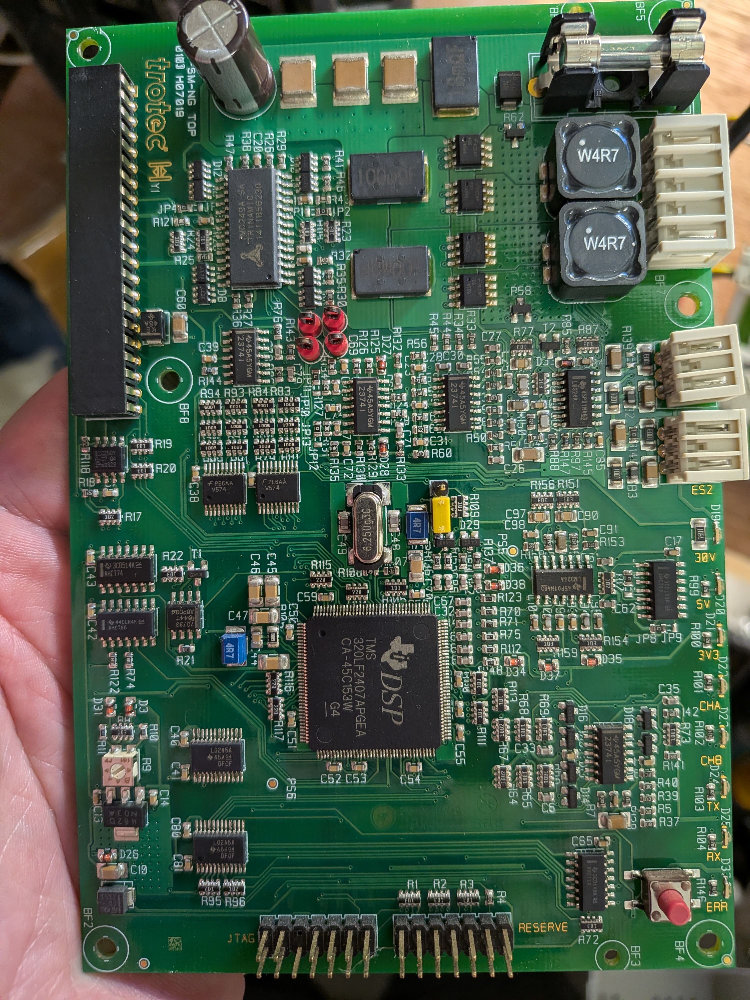
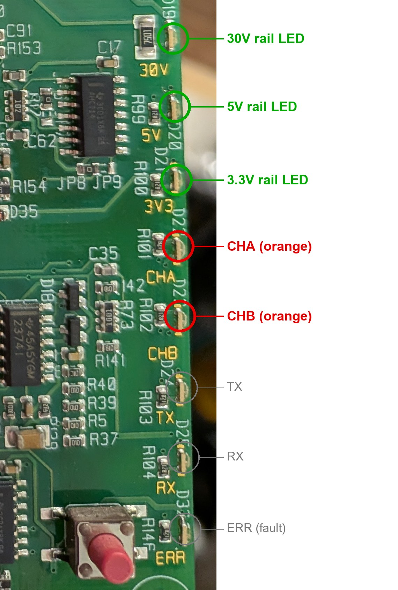
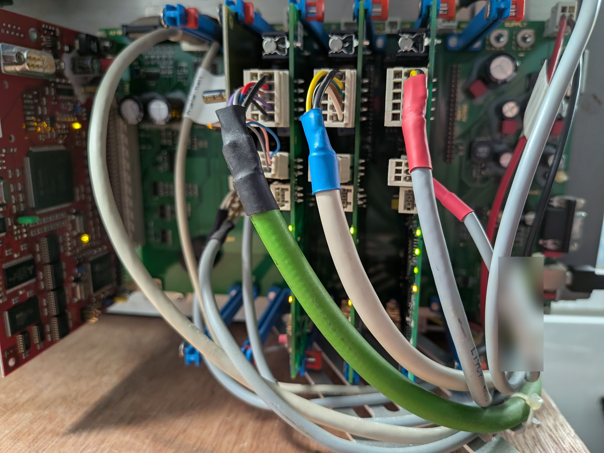
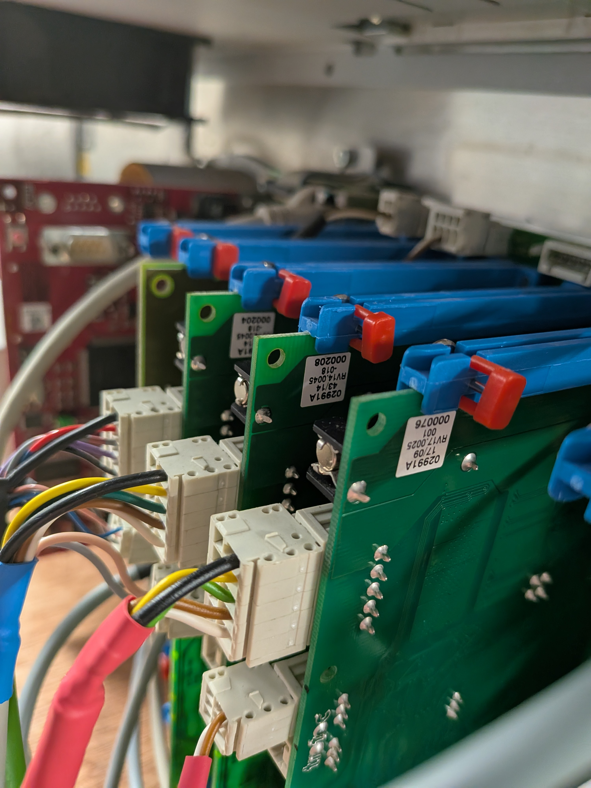
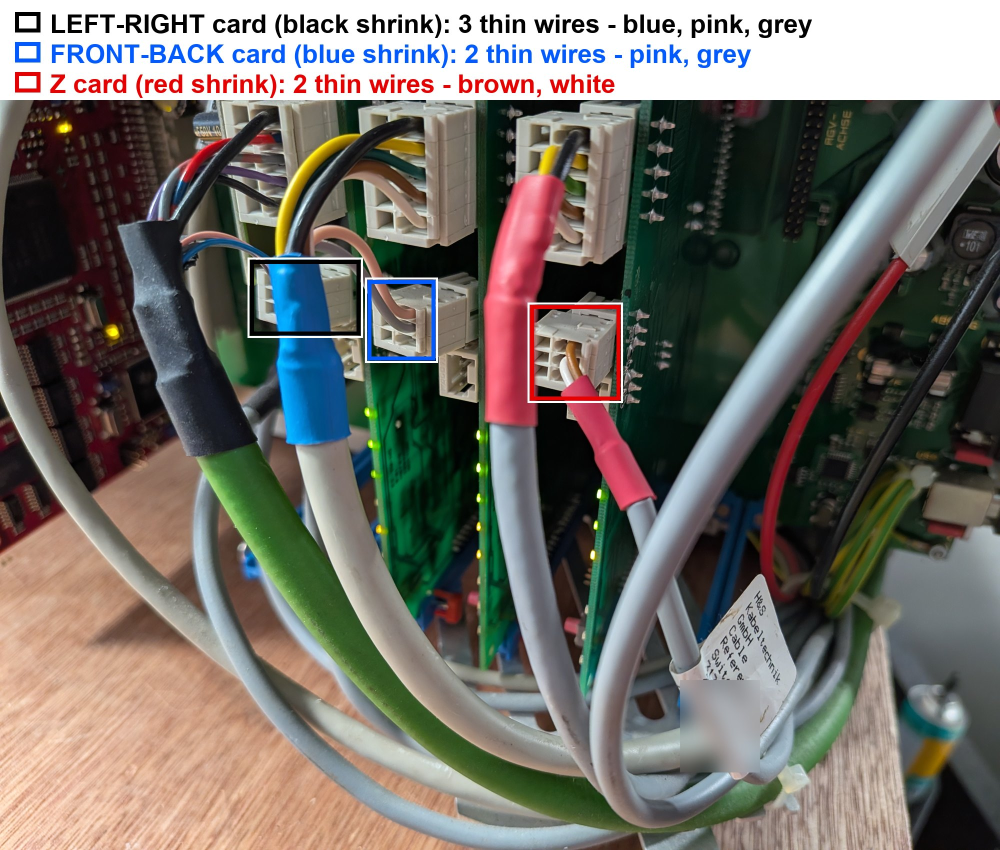

# raybreak

**Open-source control of Trotec Rayjet laser engravers from Windows 11, with no original software.**
We decoded the machine's serial protocol, and the head (left-right) and table (Z) already move on command from Python.
**One mystery is left: the front-back beam axis never moves, and we need your eyes, hands and machines to solve it.**

<p align="center"></p>
<p align="center"><em>Our Rayjet 50, driven over USB from a Windows 11 laptop.</em></p>

[](LICENSE)


> **Use at your own risk.** Scripts move real hardware. Keep the laser tube disconnected while testing motion, power off and unplug before touching connectors. No affiliation with Trotec.

## License
Free to use, copy, modify and share for any purpose (personal, educational, in your workshop or business), under the MIT license **plus the Commons Clause**: you may **not sell** the software, or a product or service whose value comes mainly from it. Full text in [LICENSE](LICENSE). Because of that restriction this is *source-available*, not "open source" by the OSI definition. The documentation and photos are covered by the same terms.

## Who is this for?
- **Rayjet / Speedy2 owners** whose original Windows software no longer runs on modern Windows, or who want to script their machine.
- **Tinkerers and reverse engineers** who like serial protocols, stepper drivers and a good open puzzle.
- **Anyone with an electronics bench** (a multimeter is enough for most tests).

## Get involved in 5 minutes
1. **Run the read-only report** on your machine (it moves nothing, writes nothing, and skips the serial/licence block):
   ```bash
   pip install pyserial
   python tools/rayjet_report.py --port COM3
   ```
   Then open a [Compatibility report](../../issues/new?template=compat-report.yml) and paste the result. A sample is in `data/example-report-rayjet50.md`.
2. **Do a hardware test** from [TODO.md](TODO.md) if you have the same machine, then post it with the [Test result](../../issues/new?template=test-result.yml) form.
3. **Ask questions or share ideas** in [Discussions](../../discussions).
4. Read [CONTRIBUTING.md](CONTRIBUTING.md) for ground rules (safety, your own words, Windows-11-safe methods only).

## Where to look
| I want to... | Go to |
|---|---|
| see what works and what does not | section 1 below |
| learn the commands and packets | sections 4-7 below, `docs/Rayjet-Command-Reference.md` |
| understand the cards, LEDs and cable colours | `docs/Wiring-and-Card-Photos.md`, `docs/Rayjet-Board-Diagnostic-Guide.md`, `docs/Reference-Switch-Hypothesis.md` |
| help solve the front-back axis | section 9 below and [TODO.md](TODO.md) |
| get an overview of the machine and its start-up | `docs/Machine-Overview.md` |

## What we most need
- Owners of **other Rayjet 50/30/other Speedy2 machines**: does your front-back axis move with these scripts? Which card/firmware?
- Someone with a **working front-back axis** to photograph their blue-card jumpers, pink rotary part and LED behaviour during moves.
- Anyone who recognises the **SM-NG driver cards** (Trinamic TMC249 + TI TMS320LF2407) and can explain what the **CHA / CHB** LEDs and the jumpers mean.
- People who can **measure** (voltages, motor winding resistance) and report numbers.
- Ideas for a friendlier tool: a GUI, a job sender, Linux/macOS support.

---

## 1. Current status (end of the 2026-11-13 session)

| Part | State |
|---|---|
| Connect, handshake, baud switch | **Works.** Reliable once the machine is "ready". |
| Packet protocol (framing, CRC, polling) | **Fully decoded and working.** |
| Status reads (state, X/Y, Z positions) | **Works.** |
| Parameter table read (256 entries) | **Works.** Dumped and explained. |
| Left-right axis (the head along the beam, protocol "X") | **Works.** Verified: 10000 steps = 50 mm, +X = right. Drew a 50 mm circle. |
| Z axis (table up/down, 145 mm travel) | **Works** (command path open; see notes). |
| **Front-back axis (the whole beam, protocol "Y")** | **Does NOT move.** The controller counts the steps, reports the move complete, raises no error, and the card's LEDs react, but the beam stays put. Open problem. |
| Laser firing | Never tested, never enabled. |
| Persistent write (`85` store) | Never sent. |

The open problem is a *physical* one until proven otherwise (motor plug/winding, drive current, coupling, or a limit/direction condition). Section 9 lists what has been ruled out and what is left.

---

## 2. Naming of the axes (read this first)

Trotec's own material calls the whole beam assembly the "X axis". We do **not**; we name axes by what you see:

| Our name | What moves | Protocol field | Travel |
|---|---|---|---|
| left-right | head carriage along the beam | X | 0-475 mm |
| front-back | the whole beam, toward/away from the operator | Y | 0-314 mm |
| Z / table | work table up/down | Z | 145 mm |

The mapping X = left-right was confirmed by moving the head. Y = front-back is inferred from the 314 mm travel limit.

---

## 3. Two languages on one serial port

The machine speaks two different protocols on the same COM port.

| | ASCII console | Packet protocol ("SF") |
|---|---|---|
| When | right after power-on, always | after the `TS;` handshake, **only when the machine is ready** |
| Speed | 19200 8N1, DTR on | 460800 for our firmware (set by the handshake reply) |
| Use | status reads, handshake; commands are mostly ignored | everything real: moves, parameters, diagnostics, job data |

The machine drops back to the console by itself some time after the last packet. If a previous session left it in packet mode, the handshake simply retries until the machine answers (the library retries up to 120 times, 0.7 s apart).

### "Ready" vs "not ready"
`GS;` returns `0` (ready) or `1` (not ready). In the not-ready state the `TS;` handshake gets no reply and the Z buttons do nothing. On our machine it happens after some power-ups and it ended each time the front-back beam was moved a few millimetres **by hand**. This strongly suggests that the machine's own power-on referencing waits for the front-back axis, which cannot move itself.

---

## 4. The ASCII console

### Syntax
- Send `\n\n\n` + text + `;` (three newlines first, semicolon last).
- Only the **first two letters** are the verb. `STATUS;` is read like `ST`.
- Arguments follow the verb, comma-separated decimal numbers, **no spaces**.
- Wrong argument count: the machine replies `Illegal number of parameters! Command ignored.` and does nothing. This reply proves the verb exists, so it was used as a safe way to detect verbs.
- Unknown verbs get no reply at all.

### Commands (all tested live)

| Command | Args | Typical reply | Meaning / notes |
|---|---|---|---|
| `GP;` | 0 | 9-line block (below) | identity and licence block |
| `GS;` | 0 | `0` or `1` | 0 = ready, 1 = not ready |
| `GE;` | 0 | `0` | error code, 0 = none |
| `GF;` | 0 | `GetSupportedOptionsMask: 5` and `GetActiveOptionsMask: 1` | option bit masks; meaning of the bits unknown |
| `GQ;` | 0 | `9997` | meaning unknown |
| `GX;` `GY;` `GZ;` | 0 | an integer | live position counters. X/Y read 0 until referenced; Z reads 0 in the not-ready state |
| `GO;` or `GO a,b,c,d,e;` | 0 or 5 | silent | accepted, **no motion** from the console |
| `PU` | 5 | silent | accepted ("pen up"), no motion |
| `PD` | ? | silent | "pen down" = laser-enable in HPGL. **Never send.** |
| `ST a,b,c;` | 3 | silent | accepted, no visible effect |
| `RS a,b,c,d;` | 4 | silent | accepted, no effect (7 argument patterns tried) |
| `ID a;` | 1 | silent | a setter of unknown effect. Avoid. |
| `PS ...` | 2 or 5+ | silent | the "set parameter" file syntax (`PS index,value`); effect on this console unknown. Avoid. |
| `GC` | 0, 5 or 6+ | silent | exists; effect unknown |
| `TS;` | 0 | `04.02-21.00-06.62` | the handshake (only when ready) |

Verb search results: only G-verbs E F P Q S X Y Z O C exist; 18 more candidates (IN HM HO RF EN CE RE VS SP CL RT HE FH FE LS LO HI IM) do not. The full 676-verb sweep was **not** redone because an unknown verb that accepts dummy arguments could actually run something.

### `GP;` reply format
Nine lines of `NAME: value` (values below are illustrative; the CPU ID is machine-specific and omitted):
```
CPU_ID: <redacted>
LASER_POWER: 0
LASER_SOURCE: 0
LOAD_COUNTER: 12
END_DATE: 0
CURRENT_DATE: <unix-like number>
JOBS_TO_ENGRAVE: <number>
TIME_TO_ENGRAVE: <number>
LICENSE_MODE: 40
```
`GP` is a pure read. This is licence / pay-per-use data and carries nothing about motion.

### Example console exchange
```
host  >  \n\n\nGS;
mach  <  0
host  >  \n\n\nGE;
mach  <  0
host  >  \n\n\nGF;
mach  <  GetSupportedOptionsMask: 5
         GetActiveOptionsMask: 1
host  >  \n\n\nGO1,2;
mach  <  Illegal number of parameters! Command ignored.
host  >  \n\n\nTS;
mach  <  04.02-21.00-06.62
```

---

## 5. Handshake and baud switching

`\n\n\nTS;` at 19200 returns exactly 17 characters in the form `NN.NN-NN.NN-NN.NN`, e.g. `04.02-21.00-06.62`.

- **Field 1** (`04`) = protocol mode. Only mode 4 (the SF packet protocol) is implemented here.
- The **digit after the dot** in field 1 selects the new baud rate: `1` = 230400, `2` = 460800, anything else = 115200. Ours has `2`, so **460800**.
- The other fields are firmware/version information; their meaning is not decoded.

After the reply: wait ~50 ms, reopen/re-rate the port at the new speed, flush the input buffer, and start sending SF packets.

---

## 6. The SF packet protocol

### 6.1 Framing
```
'S' 'F'  seq  type  extLen  lenHi lenLo  crcHi crcLo      9-byte header, CRC covers the first 7 bytes
[ ext bytes (extLen)   crcHi crcLo ]                       present only when extLen > 0
[ data bytes (len)     crcHi crcLo ]                       present only when len > 0
00 00                                                      two padding zero bytes
```
- `type`: `0x00` from the PC, `0x80` from the machine.
- `seq`: starts at 0, wraps at 255; the machine echoes it.
- **CRC**: CRC-16/ARC (polynomial 0xA001 reflected, initial value 0), stored **big-endian**. Self-check: CRC of `"123456789"` = `0xBB3D`.
- All multi-byte numbers are **big-endian**.
- The **ext** part carries *requests for status/parameters/diagnostics*. The **data** part carries *commands* (the command stream).

### 6.2 Idle poll
ext = `10 2C 2E`, data = one filler byte `00`. Exact bytes with seq 0:
```
53 46 00 00 03 00 01 63 5c  10 2c 2e 19 9d  00 00 00  00 00
```
Reply ext items:

| Tag | Payload | Meaning |
|---|---|---|
| `11` | 4 bytes | machine state. Byte 0: `03` = idle, `04` = moving. Other bytes unknown |
| `2D` | be32 X, be32 Y | position counters in steps |
| `2F` | be32 Z | table position counter |

### 6.3 Status/parameter/diagnostic requests (ext part)

| Request | Meaning | Reply tag |
|---|---|---|
| `10` | machine state | `11` + 4 bytes |
| `2C` | X and Y position | `2D` + be32 + be32 |
| `2E` | Z position | `2F` + be32 |
| `20 idx` | read parameter `idx` (several can be stacked; 16 at a time works well) | `21 idx <be32 a> <be32 b>` (b is the value) |
| `87 hh ll` | diagnostic value number `hhll` | `88 hh ll <be32 a> <be32 b>` |

**Key finding:** parameter and diagnostic reads go in the **ext** part and are answered **in the same reply packet**, not on later polls. An early version sent them in the data part, which returned nothing.

Parameter read example (index 3, seq 0): `53 46 00 00 02 00 01 a3 0d  20 03 c1 59  00 00 00 00 00`

### 6.4 Reply tag lengths (needed to parse a reply's ext block)
`0F`:2, `11`:4, `21`:9, `2D`:8, `2F`:4, `43`:0, `88`:10, `A1`:0, `A5`:2, `AB`:5, `AD`:0, `AF`:0, `B4`:4, `B8`:2, `BC`:4, `C0`:4, `C4`:4, `C8`:4, `CC`:1. The parser stops at the first unknown tag. Tags `43/A1/AD/AF` are one-byte flags of unknown meaning; the `A5`-`CC` group belongs to licence / pay-per-use data.

---

## 7. The command stream (data part)

### 7.1 Move (tested, works for X)
```
46 00                    select/prefix (always 00 here)
1A DA <be32 speed>       set parameter 0xDA = speed in steps per second
9E <be32 x> <be32 y>     move to absolute X,Y in steps
86                       end of block
```
Move to X=2000 steps (10 mm), Y=0 at 4000 steps/s:
```
46 00 1a da 00 00 0f a0 9e 00 00 07 d0 00 00 00 00 86
```
Wrapped in a packet together with the idle poll request (seq 0):
```
53 46 00 00 03 00 12 ae 1d  10 2c 2e 19 9d  46 00 1a da 00 00 0f a0 9e 00 00 07 d0 00 00 00 00 86 01 b1  00 00
```
After sending, keep polling (`10 2C 2E`) until the reported X/Y equal the target **and** state byte 0 is no longer `04`.

**Scale:** X = **5 micrometres per step** (user-verified: 10000 = 50 mm, +X = right). Y is stored as 3.75 um per step but is unverified because that axis never moves. Positions are *counted steps*, open loop. They are not measured positions.

### 7.2 Writing parameters (decoded; only `1A DA` tested)
| Bytes | Meaning |
|---|---|
| `1A idx be32` | set 32-bit parameter |
| `1C idx be16` | set 16-bit parameter |
| `1E idx byte` | set 8-bit parameter |
| `85` | **store all parameters permanently** - never sent casually |

Parameters known to be written: 32-bit `0B 0C 0D 0E BD DA DB DD 4E`; 16-bit `D3 C4 4A D4 4C D6 D8 4D D7 DE`; 8-bit `C5 C8 CF DF`.

### 7.3 Other opcodes decoded, never sent
`9F` (alternate move), `A6` (Z move, be32), `A8` (second Z-type move), `80`, `44`, `32`, `0A/0C` (channel byte), `A2`, `8A/8C/8E/90`, the `B1 B3 ... CF` set/enable pairs (job power/speed/pulse values, inferred), and the `AA AB AC AE` licence area. Full layouts: `docs/Rayjet-Command-Reference.md`.

### 7.4 Risk classes
| Class | Items | Rule |
|---|---|---|
| Read only | console getters, `10 2C 2E`, `87`, `20` | safe whenever ready |
| Reversible | `1A 1C 1E` | RAM only; power cycle restores. Write one at a time, read back first |
| Persistent | `85` | overwrites stored parameters. Only after a saved full dump |
| Licence / unknown | `AA AB AC AE`, opaque opcodes | do not send |
| Laser | `PD`, job data | never unless intended |

---

## 8. The parameter table ("FRAM")

256 entries read and saved (`data/parameter-dump.md`, explained in `docs/Rayjet-Parameter-Table.md`). Explained entries:

| Index | Value | Meaning |
|---|---|---|
| 0x03 | 5000 | X step 5.000 um |
| 0x04 | 3750 | Y step 3.750 um |
| 0x05 | 192 | Z step 0.192 um |
| 0x07 / 0x08 | 94400 / 62800 | X / Y travel in 5 um units (472 / 314 mm) |
| 0x4A, 0x4C | 350, 50 | laser "tickle" delay and minimum power |
| 0x0B-0x0E | 100000 / 304800 / 100000 / 40000 | four acceleration-like settings (unconfirmed) |
| 0xBE-0xF9 | equal to own index | padding/system area, not settings |

Conclusion: the stored values match a Rayjet 50, so the settings were not wiped, and the table shows no axis-enable flag for any axis. The diagnostic channel (`87`) returns data only for ids 0-8 (id 8 = 1023).

---

## 9. The front-back problem: what we know

**Symptom:** commanding Y changes the Y counter, the machine reports the move done, no fault appears, the blue card's LEDs react (and the machine beeps at times), but the beam does not move.

**Hardware identified** (photos and cable colour guide: [docs/Wiring-and-Card-Photos.md](docs/Wiring-and-Card-Photos.md)): CPU card "Speedy2 CPU rev 2.0" plus three "SM-NG" driver cards: A = left-right, B (blue) = front-back, both from 2014; C = Z, a different board type from 2009. Each driver card has LEDs 30V / 5V / 3V3 (green), CHA / CHB (orange), TX, RX, ERR.

**The driver card and its status LEDs** (details in [docs/Wiring-and-Card-Photos.md](docs/Wiring-and-Card-Photos.md)):




Green circles: the 30V / 5V / 3V3 rail LEDs, which looked lit on the driver cards (present, not measured). Red circles: CHA / CHB, whose meaning is unknown. Live camera crops of the blue card's pair, both lit and both dark:

 

**Motor cables and card stickers** (which cable goes to which card):

 

**Ruled out (as far as software can tell):**
- Protocol, framing and scale are right: the same packets move the left-right axis.
- Cover interlocks work (observed by the owner).
- The stored parameters match a Rayjet 50.
- No fault code (`GE` = 0) and no per-axis status difference found in any tag or diagnostic id.
- No console or packet command to "enable" an axis is known.

**Tests run on the front-back axis** (all reported complete, none moved the beam): 50 mm out and back, 10 mm, 3 mm, 25 mm, at 1500 and 4000 steps/s, with camera observation of the card LEDs.

**LED observations (owner + camera):** on the blue card the CHA/CHB pair sometimes blinks, goes dark together during moves, or alternates; meanings are unsettled. Hypotheses: home/limit/range indicators versus drive-phase/activity indicators. Camera evidence leans to activity-linked, but that is inference. LEDs cannot be forced from software.

**New lead (needs testing):** each driver card has thin return wires from reference/limit switches. The owner counts 3 on the left-right card, 2 on the front-back card and 2 on the Z card, and the photos confirm it (the front-back card has a pink and a grey wire, the left-right card also a blue one). A missing or faulty reference-switch circuit would fit "counts steps, reports done, never moves" and the "not ready until the beam is nudged by hand" behaviour. Details and tests: [docs/Reference-Switch-Hypothesis.md](docs/Reference-Switch-Hypothesis.md).



**Remaining suspects and decisive tests (hardware)** - tracked step by step in [TODO.md](TODO.md):
1. Motor plug/cable on the blue card (reseat, inspect).
2. Beam motor winding: multimeter, expect two winding pairs of a few ohms each with no continuity between pairs.
3. Swap only the motor plugs between the blue and green cards (power off): if the fault follows the motor, it is motor/cable; if it stays with the card, it is the card.
4. Compare the pink part (possible current setting) and jumpers on the blue card versus the green card.
5. Move the beam by hand to mid-travel before commanding (rules out a rest-position/limit condition).
6. A rotary-attachment socket fault (controller wrongly believing a rotary device is attached) is a hypothesis only.

---

## 10. How the pieces were discovered (methods)

1. **Console probing** on COM3: found `GP`/`GS`/`GE`... by sending verbs and watching for replies or the "Illegal number of parameters" error.
2. **Packet structure:** worked out from the handshake reply, the framing and CRC, and many small experiments with status requests and parameter reads.
3. **Mistake fixed:** parameter reads were first sent in the data part; they belong in the ext part, and the answer comes in the same packet.
4. **Scale check:** a 10000-step move gave a visible 50 mm shift to the right, fixing 5 um/step and +X direction.
5. **Camera method:** the Windows Camera app showed the card LEDs while scripted moves ran with timestamps.
6. **Cross-checks** of start-up, interlock and rotary-attachment behaviour against what the machine actually does on power-up.
---

## 11. Repository layout

```
docs/    machine overview, command reference, parameter table, board/LED diagnostic guide, wiring and card photos
tools/   Python scripts (pyserial)
data/    one read-only parameter dump
images/  photos of the driver cards and motor cables (see docs/Wiring-and-Card-Photos.md)
```

### Tools
| Script | Purpose |
|---|---|
| `rayjet_sf.py` | **core library**: connect/handshake, CRC, packet build/read, `xfer`, `parse_status`, `be32` |
| `rayjet_cmds.py` | encoders only (dry run): set32/16/8, read_param, store_params, move_xy, move_z, ext_diag |
| `rayjet_move_test.py` | simple X/Y move test |
| `rayjet_circle.py` | draws a 50 mm circle with the left-right and front-back axes |
| `rayjet_axis_exercise.py` | alternates left-right and front-back moves with announcements |
| `rayjet_params.py` | **read-only** dump of the parameter table |
| `rayjet_diag.py` | **read-only** diagnostic id scan |
| `rayjet_survey.py` | read-only survey of extra status tags (never run) |
| `gs_watch.py` | read-only console logger (never run) |
| `led_run.py`, `slow_fb.py`, `slow_lr.py`, `matrix_run.py` | slow or scripted moves used for the camera/LED tests |

### Quick start
```bash
pip install pyserial
python tools/rayjet_cmds.py              # prints encoded packets, talks to nothing
python tools/rayjet_sf.py COM3           # handshake + 3 status polls (machine must be ready)
python tools/rayjet_params.py            # read-only parameter dump
```
Minimal move:
```python
from rayjet_sf import Rayjet, be32, parse_status
rj = Rayjet("COM3", verbose=False).connect()
mv = lambda x, y, v: bytes([0x46,0,0x1A,0xDA]) + be32(v) + bytes([0x9E]) + be32(x) + be32(y) + bytes([0x86])
rj.xfer(data=mv(2000, 0, 4000), ext=bytes([0x10,0x2C,0x2E]))   # 10 mm right at 4000 steps/s
print(parse_status(rj.xfer()["ext"]))
rj.close()
```
Edit the COM port for your machine. The machine must report `GS;` = 0 first.

---

## 12. Open questions
1. Why the front-back axis never physically moves while the controller counts and completes the move.
2. What the second state byte and the flags `43 / A1 / AD / AF` mean.
3. What CHA/CHB on the driver cards really indicate.
4. Whether the newer-generation connect step (selecting engraver type, syncing FRAM settings) matters; this is only an inference.
5. What `GF` masks, `GQ`, `GC` and the unused opcodes do.

