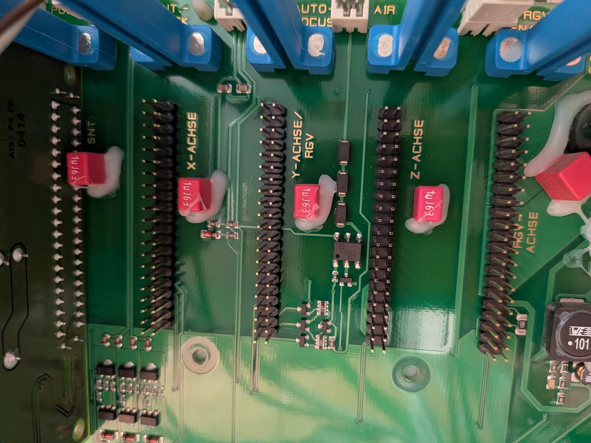

# Slot labels, card swaps, motor-plug swap and the "activation" problem (2026-11-14)

Owner observations and our reading of them. OBSERVED = seen by the owner or logged by us. INFERRED = our reasoning, not proven.

## 1. Slot and card naming (from the backplane silkscreen)

The rack backplane has a labelled connector for each slot. Readable labels: **SNT** (far left, probably the power-supply slot), **X-ACHSE**, **Y-ACHSE / RGV**, **Z-ACHSE** and a fourth **RGV-ACHSE**. Along the top edge there are headers marked **AUTO-FOCUS** and **AIR** and others partly hidden by the card levers (one starts with "INT." and ends in "CK", probably the interlock). "ACHSE" is German for axis.

| Slot label | Card (cable shrink colour) | Axis in our terms | Protocol |
|---|---|---|---|
| X-ACHSE | **black** | left-right (the head) | X |
| Y-ACHSE / RGV | **blue** | front-back (the beam) | Y |
| Z-ACHSE | **red** | Z (the table) | Z |

"RGV" is probably the abbreviation of the rotary engraving attachment (INFERRED from the German context, unconfirmed). If so, the Y slot is shared with, or tied to, the rotary attachment, which matches our earlier hypothesis that the Y output could be steered to the rotary connector (see `docs/Machine-Overview.md`, section 8). Open question: is the fourth slot, **RGV-ACHSE**, populated by a card?

## 2. What the owner tried (2026-11-14)
1. **X card moved into the Y slot.** The machine would not reach its enabled (ready) state afterwards.
2. **Y card swapped with the Z card.** No response from the machine.
3. **Cards back in their original slots, then the X and Y motor plugs swapped.** Commanding the X axis then physically moved the front-back beam (our reading of the description; please correct us if it was the other way round). So the beam motor, its cable and the motor power supply are good, and the fault sits on the Y side of the electronics.
4. **Y reference-switch plug.** Unplugging and re-plugging the plug of the zero (reference) switch on the Y card enables the machine, exactly like nudging the beam by hand did.
5. **X reference-switch plug.** Doing the same on the X card makes the machine **fail and lock into a safe mode that needs a hard reset**. Not yet tested on Z. **Do not repeat the X version casually.**
6. **Cards compared visually.** All three look identical, including the small rotary part at the lower left, so any difference is probably in software or settings, not jumpers.
7. **Y motor feel.** The Y motor seems to be energised but may not hold as firmly as the X card does when the X card drives it.
8. The machine's USB adapter now appears as **COM4** (it was COM3). The scripts take the port as an argument or need a one-word edit.

## 3. What this suggests
- The card swaps failing suggests each card is tied to its slot. The cards look identical, so the axis identity probably comes from the backplane slot wiring (coding pins on the slot connector) or from a stored setting. Either way, **cards are not interchangeable**, so card swapping is not a safe test.
- Test 3 is the strongest evidence so far: with the X electronics driving the beam motor, the beam moves. The Y card's output stage, or something that enables it, is the problem. Section 4 explains why a weaker hold points the same way.
- Tests 4 and 5 show that the reference-switch state is part of the start-up logic. A reasonable reading (INFERRED): start-up referencing needs to see each axis's switch change state. On Y the controller is stuck waiting; toggling the switch plug supplies the change and the machine continues. On X the same trick looks like a fault (a switch that is open when it should not be), so it trips safe mode.
- If that is right, there should be a command, or a state we can read, that corresponds to "Y referenced / enabled". Finding it is the main software goal (section 5).

## 4. Hardware ideas
- **Thermal camera.** With the machine ready and holding position, compare the temperature of the Y card's driver chip and the surrounding parts against the X card's. A dead stage runs cold; a stressed one runs hot.
- **Hold test.** Compare how hard each axis resists a gentle push by hand while energised. Use the same motor on both cards (the plug swap you already did) to separate the motor from the card.
- **30 V is reported by the Y card's LED, but the LED only shows the rail is present.** Measure the motor-side voltage and the driver output with a multimeter or oscilloscope while stepping.
- **JTAG.** Both driver cards have a JTAG header next to the DSP. Dumping the firmware and settings of the X and Y cards for comparison could show the difference directly. This needs a suitable adapter and care; do not write anything to the cards.
- **Z reference switch.** Check what unplugging it does (only when ready to hard-reset if needed).

## 5. Software angle
The goal is to find what the unplug-replug trick does inside the controller, without touching the plug. See `TODO.md` section 7 for the plan: record everything the machine will report (console flags, status bytes, the diagnostic values, the parameter table) before, during and after the Y switch is unplugged and replugged, then look for any value that flips. A value that flips is the activation flag; the question then becomes which command can set it.
