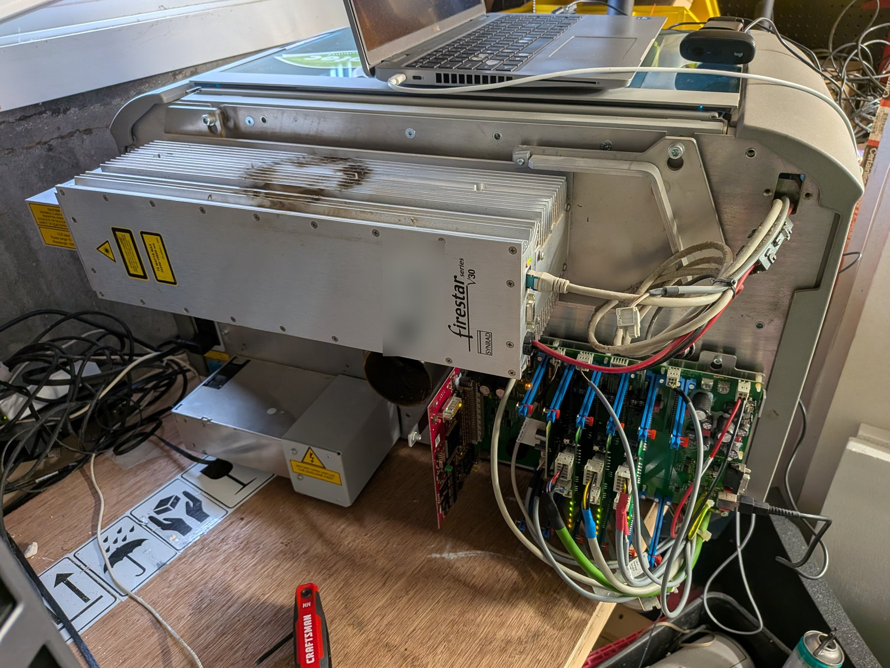
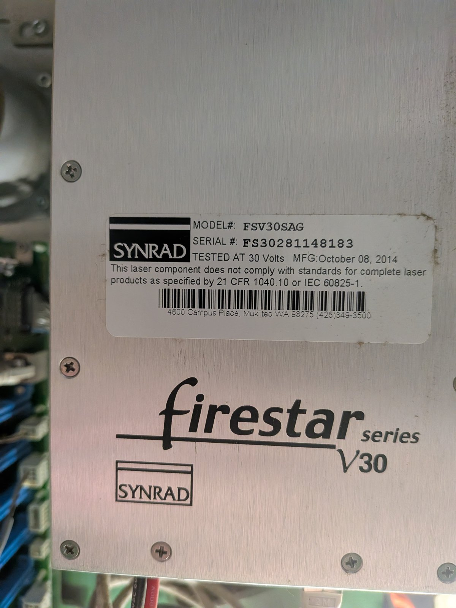
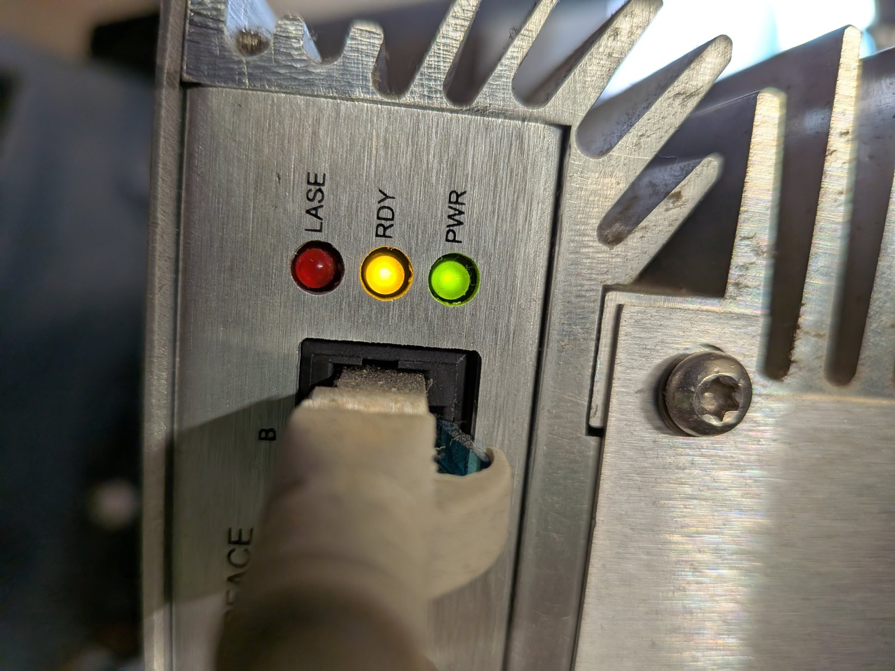
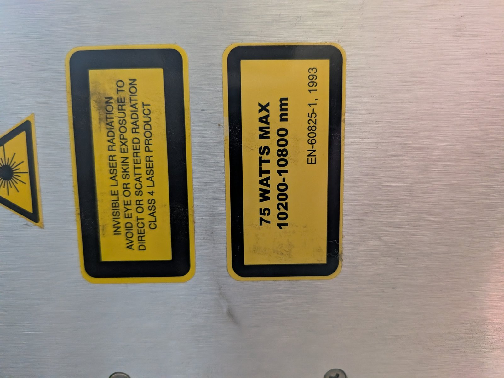

# The laser source: Synrad Firestar v30 (2026-11-14)

Identified from the laser's own labels. This is the sealed CO2 source inside our Rayjet 50.

## Identification
- Maker: Synrad. Series: Firestar v. Model: FSV30SAG. Made October 2014. Runs from a 30 V DC supply.
- Type: RF-excited, sealed CO2 laser, wavelength ~10.6 um (the 10200-10800 nm on the label is the CO2 band).
- Rated 30 W (the "75 WATTS MAX" sticker is a generic safety-label ceiling for the housing, not this unit's output;
  the v30 model and "tested at 30 V" identify it as the 30 W version). Class 4.
- The unit's serial number is readable on the label photo below.

## The connector that looks like "ethernet"
- The cable is a modular RJ-style connector plugging into the jack labelled "Interface B" on the laser, with three
  status LEDs beside it: **PWR** (power), **RDY** (ready / armed), **LASE** (actively lasing).
- This is **not** a network/ethernet link. On the Firestar the interface connectors carry the laser's control and
  status signals. The Firestar v-series normally has two such jacks (Interface A and Interface B).
- Observed LED state while powered: PWR green on, RDY yellow on, LASE red off = the laser has power, is ready/armed,
  and is not firing. So the laser source itself is healthy. This supports the conclusion that our fault is the Y
  axis, not the laser.

## How it connects to the controller
- The Interface cable runs from the laser's Interface B jack to the Rayjet controller board (the main green board),
  not to the PC. The PC only reaches the controller over USB-serial; it has no link to the laser (the PC's ethernet
  port is disconnected - verified).
- So the controller is what drives the laser. On Synrad RF lasers the control is a 5 V **PWM command** signal
  (a low-duty "tickle" keeps the plasma primed; higher duty = more power) plus a gate/enable and an interlock. The
  controller generates these on the interface cable; there is no packet "handshake" on the control line.

## Is there a protocol we could talk to? (correction, 2026-11-14)
- An earlier version of this page said the Firestar has an RS-232 command interface. **That was an unsupported claim
  from memory and is withdrawn.** The manual pages we could find for the v30 describe a hardware interface only:
  control and status lines on the connectors, plus the three LEDs. No serial command set turned up.
- What the manual snippets do say (partial, still to be checked against the full table before any wiring):
  - Interface B (RJ45): pin 1 = PWM positive, an optoisolated input for the PWM/tickle signal; pin 2 = a 15 V DC
    output (so it must never be connected to a logic input); pin 6 = laser-enable related input; pin 8 = ground.
  - The OEM v30 has a **built-in tickle generator** (a pasted outside summary claimed the opposite).
  - The laser has two interface connectors, A (DB-9, for new installations) and B (RJ45, legacy). **Never connect both
    at once; the manual says that can damage the laser.** Our photos show the RJ45 (B) in use.
  - Status information comes from the LEDs and from status outputs on the interface connectors.
- So the practical test is not "send a command and read a reply" but "watch what the controller does to these lines".
  A passive monitor sketch for that has been prepared but not run. Plugging the RJ45 into a PC network port is not
  useful (it is not Ethernet) and is not recommended.

## Safety note
- When RDY is lit the laser is armed: if the controller asserts the PWM command and gate, it WILL fire. Watching the
  laser's status lines passively is safe; driving any PWM, enable or gate line is not. Never command lasing without the
  beam contained, the interlock managed and people clear.

## Photos

The laser sits above and behind the controller rack. The RJ45 cable runs from the laser's interface jack to the
controller area, the red and black cables are the 30 V supply, and the laser has further connectors below the RJ45.
A second cable end with a plug hangs loose beside the laser in this photo; what it is has not been checked.

Model FSV30SAG, Firestar series v30, tested at 30 V, made October 2014. The laser's serial number is on this label.

Interface B jack with the RJ45 cable plugged in and the three status LEDs: LASE (red, off), RDY (yellow, on) and
PWR (green, on).

Class 4 invisible-radiation warning and the output-power/wavelength label (the 75 W figure is the housing label,
not this unit's 30 W output).
