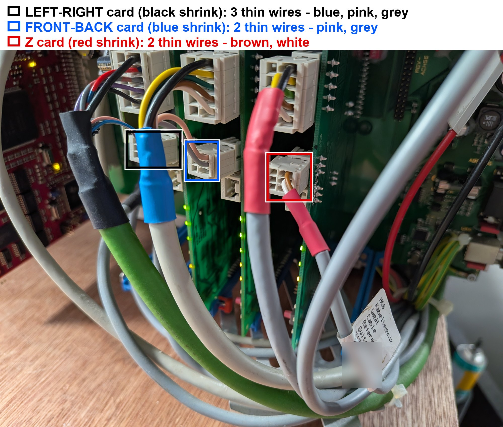
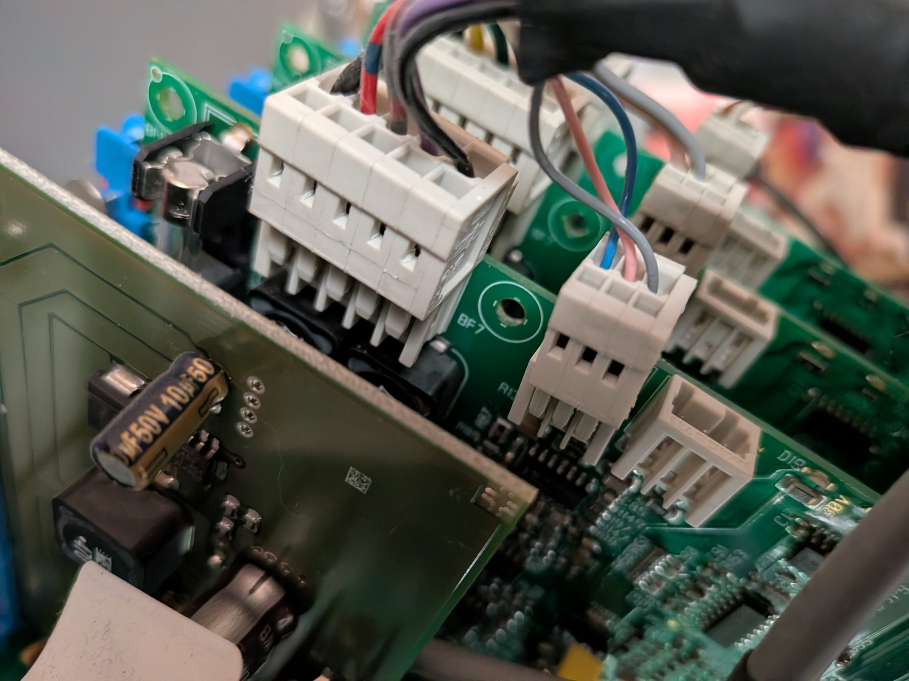
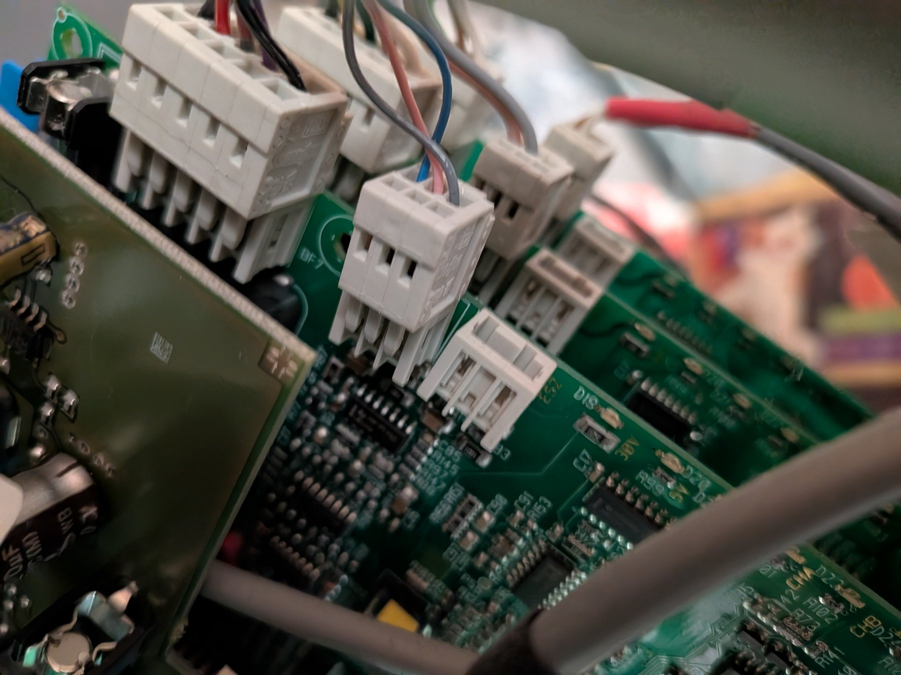

# Return wires, limit/reference switches and the CHA/CHB question

Added after the owner counted the thin "return" wires on each driver card and after an outside explanation of CHA/CHB was suggested. Everything here is **hypothesis checked against our evidence**, not established fact. Evidence labels: OBSERVED (we saw it), PHOTO (visible in our photos), INFERRED (our reasoning), UNVERIFIED (claimed, untested).

## 1. New observation: how many thin wires return to each card
Each driver card has a top spring-clamp block (the motor connection, five positions) and smaller blocks below it. The owner reports the thin wires entering the lower blocks:

| Card (cable shrink) | Axis | Thin return wires (owner count) | What our photos show |
|---|---|---|---|
| 000204 (black) | left-right | **3** | PHOTO: lower block holds three thin wires (**blue, pink, grey**), also from under the black heat-shrink of the motor cable |
| 000208 (blue) | **front-back** | **2** | PHOTO (new overview): two thin wires, **pink and grey**, enter the card's lower three-pin block; the third position is empty. They come out from under the blue heat-shrink, i.e. from the same cable as the motor wires |
| 000076 (red) | Z | **2** | PHOTO: a separate thin grey cable with its own red heat-shrink, carrying a tag that reads "Reference Switch-Z", brings **brown and white** to the lower block |

Reading: the five wires in the top block are the motor side (a two-winding stepper needs four, plus a shield/earth, which fits what the photos show but is unverified). The thin wires are signal returns, most likely from reference/limit switches or sensors. A cable tag on the Z cable reads "Reference Switch-Z", and the Z card has two return wires, which fits a plain two-wire switch.

Two-wire return = a simple switch (signal + common). Three-wire return = something with a supply line (an optical or magnetic sensor) or two switches sharing a common. So the left-right axis may use a different kind of reference device than the other two (INFERRED).

The two small three-pin connectors on each card are probably the switch inputs; one is silkscreened **ES2**. "ES" is plausibly short for the German word for end switch (INFERRED from the machine's German origin; unconfirmed).

## 2. Why this matters for the front-back fault
- Behaviour we observed: the machine can sit in a "not ready" state that ends only when the front-back beam is moved by hand a few millimetres (OBSERVED, repeatedly). The simplest reading is that the controller is waiting for a reference/limit input on the front-back axis to change.
- If the front-back card's reference-switch circuit is open, shorted, or missing a wire, the controller may believe the axis is at a limit, may refuse to drive in that direction while still counting steps, and may report the move "complete" (UNVERIFIED, but it fits "counts steps, reports completion, no motion, no error").
- Hence: finding and testing the front-back reference switch circuit is now the best lead, ahead of the motor itself. The motor tests in TODO.md remain valid; the new tests are added there.

## 3. The suggested CHA/CHB explanations, compared with the evidence

Two explanations were suggested to us; they contradict each other, so at most one can be right.

**Suggestion A - "CHA/CHB are quadrature-encoder inputs; X and Y are DC servos with encoders; on Z the pins are repurposed for limit switches."**
- Against it: the driver chip is marked as a Trinamic TMC249, a stepper-motor driver family, and the machine's own settings are stored as step sizes (5 um, 3.75 um) with positions counted open loop. Our protocol returns counted steps, not encoder positions. We found no encoder status in any tag or diagnostic value.
- Against it: on the blue card the CHA/CHB LEDs changed when we commanded moves even though nothing moved (OBSERVED). An encoder LED cannot change if the shaft does not turn.
- So: the "X/Y servos with encoders" part is not supported by our evidence. We treat it as unlikely.

**Suggestion B - "On the Z card CHA/CHB show limit-switch inputs; CHA ON in mid-travel, OFF at the top, because the switch is normally closed."**
- For it: our Z observations (OBSERVED by the owner): both off fully down, CHA lit in mid-travel, CHA off fully up. That is the pattern of a position-dependent input.
- Also consistent with a different explanation: a stepper that is parked holds one of a few coil-current patterns, and the LED could show which pattern, which also depends on where the table stopped. A switch-input LED and a drive-phase LED can both look position-dependent when the axis is moved only by the up/down buttons.
- The Z card is a **different board type** (2009, RV17) from the other two (2014, RV14), so CHA/CHB may mean something different on it. A statement like "all axes use the same card" is false for this machine (OBSERVED from the stickers).
- Verdict: plausible for Z, unproven. It is testable (section 4).

**Our working hypothesis (INFERRED):** on the two RV14 cards CHA/CHB are drive-side indicators (the two coil channels of the stepper driver, "channel A / channel B"), which explains why they react to commands without any motion. On the Z card they may be input indicators. The front-back card's LEDs reacting but nothing moving then points at the motor side or at a blocked/ignored move, not at the LEDs.

## 4. Tests that separate the explanations
These use only a multimeter and your hands. Machine states are noted; photograph connectors before touching anything.

1. **Hand-push test (power on, machine ready, motor held).** Slowly push the left-right head, then the front-back beam, by hand through their travel while watching the card LEDs (use the camera if easier).
   - An LED that flips at one particular position = a switch/sensor input. Record the position.
   - LEDs that never change as you push = drive-side indicators, not inputs.
2. **Z switch test (power on).** Move the table to mid-travel so CHA is lit. Find the Z reference switch and press it by hand (carefully, no pinching). Does CHA go off immediately? If yes, CHA is a Z limit/reference input.
3. **Continuity test (power OFF).** Disconnect the two thin return wires of the front-back card at the card end. With the multimeter on continuity or ohms across the pair, push the beam by hand end to end. A working switch should open or close at one end of travel. Always open, always closed, or erratic = a faulty switch, wire or connector. Do the same on the left-right card (three wires: test each pair) and the Z card as a comparison.
4. **Wire follow (power OFF).** Trace where the front-back card's two return wires go (which switch, where on the beam) and photograph both ends.
5. **Re-photograph** the lower connector blocks of the front-back card, close up, from the same angles as the other two cards.

## 5. Correction and what the new photos add
Our first set of photos hid the front-back card's lower block, so an earlier version of this page said it looked empty. The new photos below show **two thin wires (pink and grey)** entering it, which matches the owner's count. That statement is withdrawn.

What the photos show (PHOTO), and what we infer (INFERRED):
- The left-right and front-back cards both receive a **pink and a grey** thin wire; only the left-right card also has a **blue** one. The same colours suggest the same type of switch/sensor cable, with the front-back card using two of its three cores (INFERRED; the third position being empty is visible).
- On the two moving-beam axes the thin wires leave from under the same heat-shrink as the motor wires, so their switch or sensor is probably mounted on the moving assembly and shares its cable. The Z axis has a separate, clearly tagged cable ("Reference Switch-Z") with two wires.
- A board label near the right edge of the rack reads "RGV-ACHSE" ("ACHSE" is German for axis); we do not know what it refers to.
- The silkscreen **ES2** can be read next to a free three-pin header on the left-right card (photo 9), supporting the idea that the three-pin headers are switch/sensor inputs.
- The tag photo is blurred where it shows a person's name.

Open question for the owner: where do the pink and grey wires of the front-back cable go on the machine (which switch, at which end of the beam's travel)? A photo of that switch would be very useful.

## 6. Photos

Overview of the three cards. Each box marks the lower connector block of one card and is coloured like that card's cable shrink: black = left-right (3 thin wires), blue = front-back (2), red = Z (2).

Close-up of the left-right card: five-position motor block on top; below it a three-pin block with blue, pink and grey wires; a second, empty three-pin header beside it.

The free three-pin header marked ES2, with the CHA / CHB LED labels visible at the lower right.
