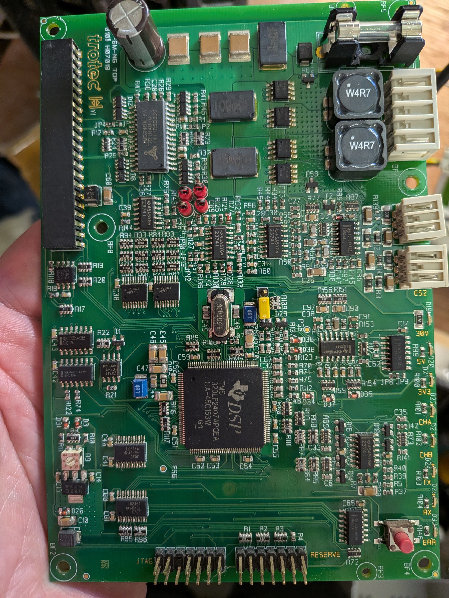
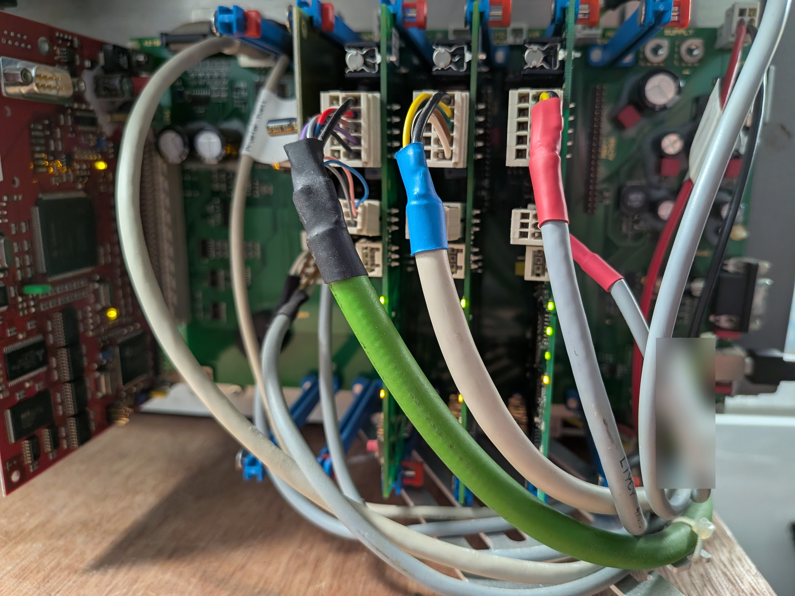
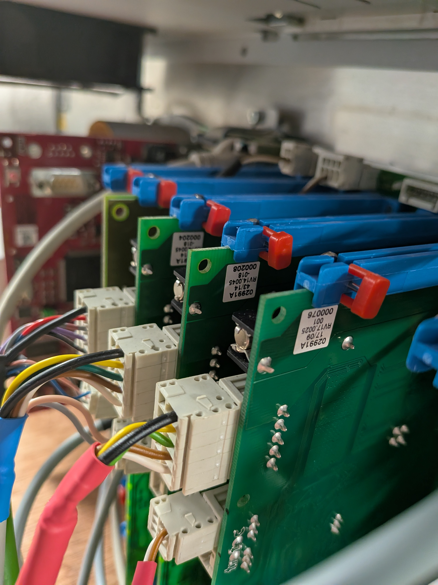
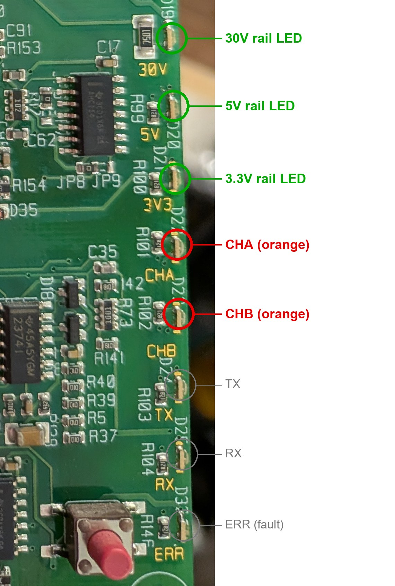
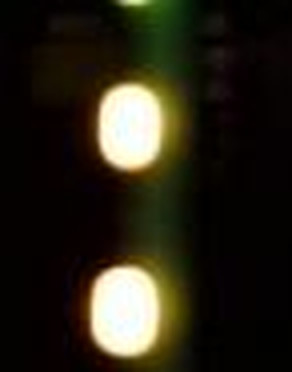
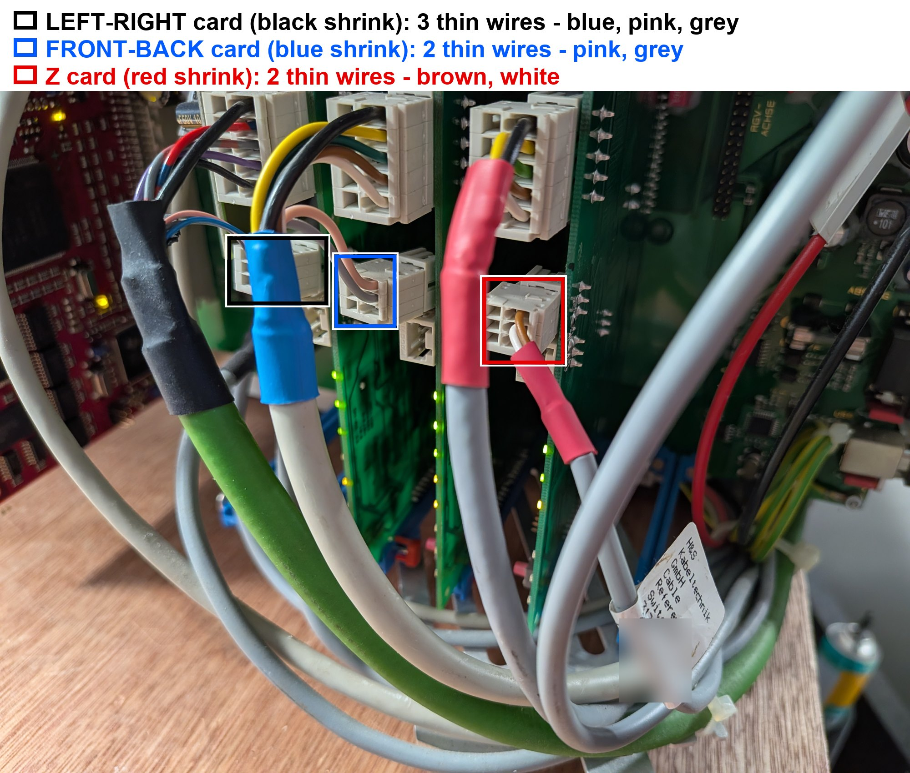

# Wiring and card photos - how to tell the cards and cables apart

Our own photos of the Rayjet 50 controller area. Descriptions are what is visible in the pictures; anything beyond that is marked as a guess.

## Which card is which
Three identical-looking green "SM-NG" driver cards sit in a rack next to the red CPU card. We identify them by the **heat-shrink colour on the motor cable** that plugs into each one, because the card positions are hard to name.

| Card label (serial on sticker) | Cable heat-shrink | Cable jacket | Drives | Notes |
|---|---|---|---|---|
| 000204, RV14.0045-018, week 43/14 | **black** | green | left-right (head) | works |
| 000208, RV14.0045-018, week 43/14 | **blue** | beige | **front-back (beam)** | the axis that does not move |
| 000076, RV17.0025, 17/09 | **red** | grey | Z (table) | different board type (2009) |

In our notes "green card" = the card on the green-jacketed cable (left-right) and "blue card" = the card on the blue-shrink cable (front-back).
The card-to-axis mapping was established by our movement tests, not read from any document.

## Photo 1 - the SM-NG driver card, top view

Visible features (reading the silkscreen and parts):
- Board name `SM-NG TOP`, Trotec logo, Trinamic **TMC249A-SA** stepper driver chip (top left), Texas Instruments **TMS320LF2407** DSP (centre), a crystal beside it.
- Status LEDs down the right edge, top to bottom: **30V, 5V, 3V3** (green), **CHA, CHB** (orange), **TX, RX, ERR**.
- Small reset push-button at the bottom right, next to the ERR LED.
- Two headers along the bottom: **JTAG** and **RESERVE**.
- Glass fuse in a holder at the top right; two `W4R7` power inductors beside it.
- Three white connectors on the right edge: one tall one at the top (motor, our reading) and two three-pin ones, the lower marked **ES2**. A cable tag in the machine reads "Reference Switch-Z", so the three-pin connectors are probably reference-switch inputs (guess).
- Jumpers: JP8 and JP9 near the right, a yellow jumper near the middle, and a row of JPxx pads beside the driver chip. Their functions are unknown.
- A small pink rotary part at the bottom left (looks like a rotary switch or trimmer; function unknown, possible current or address setting).
- Four red components below the driver chip (probably trimmers or capacitors; unknown).
- The long black connector on the left edge is the backplane connector to the rack.

Use for comparison: photograph the blue-cable card and the green-cable card in the same way and compare jumper positions and the pink part.

## Photo 2 - the three motor cables entering the cards

From left to right in the picture:
1. **Black heat-shrink, green cable** - wires visible at the terminal block: red, black, purple, blue and a pink/brown pair. (000204, left-right)
2. **Blue heat-shrink, beige cable** - wires visible: yellow, black, green, brown, white/beige. (000208, **front-back**)
3. **Red heat-shrink, grey cable** - a yellow-with-black wire (looks like yellow/green earth style) at the top of its terminal block. (000076, Z)

The red CPU card with the DB-style connector is on the far left. Green LEDs lit on each driver card are visible in the rack, and a factory inspection tag hangs on one cable (name blurred).

## Photo 3 - card stickers and the connector blocks

- Stickers, back to front: `02991A 43/14 RV14.0045-018 000204`, `02991A 43/14 RV14.0045-018 000208`, `02991A 17/09 RV17.0025 001 000076`.
- Each card uses a **white spring-clamp block** for the motor wires and a second smaller block below it; the blue/red levers are the card ejectors.
- Wire colours visible entering the blocks (left card): black, red, purple, blue, brown/pink; (middle card): yellow, black, green, brown, white; (right card): black, yellow, green, brown/orange, white. Pin-by-pin order is **not** established; before swapping or unplugging anything, photograph every block and mark the order.

## Using the photos for the motor-plug swap test
1. Power off and unplug the machine.
2. Photograph the blue-cable block and the black-cable block close up, from the same angle, so you can restore them.
3. Swap only the motor connectors between 000208 and 000204, power on, nudge the beam to make the machine ready, and command each axis (see the main README, section 9).
4. If the fault follows the motor and cable, it is the motor, cable or coupling; if it stays on the card, it is the card.

## Privacy and rights
These are our own photographs. The sticker serial numbers are board build labels, not the machine serial number (which is deliberately left out of this repository).

---

## The status LEDs, zoomed in and highlighted

Eight LEDs run down the right edge of each SM-NG card, each sitting just above its silkscreen label.

### Green power LEDs (30V, 5V, 3V3) - highlighted green
- They show that the three supply rails of the card are present. In the camera views we looked at (photo 2 above and the live camera preview during our tests) these three LEDs were lit on the driver cards and did not visibly flicker during moves. We did not log every frame, so treat this as a visual impression.
- So the card supplies **appear good** on every card, including the blue (front-back) card. This matters: it argues against a dead 30 V motor supply or a missing logic rail on that card.
- Caveat: a lit LED means the rail is present, not that the voltage is correct. To measure it, use a multimeter on the card's test points (the board shows pads labelled PS5 and PS6 in photo 1) with the machine powered, and compare the blue card with the left-right card.

### CHA and CHB (orange) - highlighted red
- These two are the LEDs we watched while moving the axes. Their meaning is **not documented anywhere we have**, so what follows is observation plus hypothesis.
- Observed on the blue (front-back) card during commanded moves: both lit, both dark together for a few seconds, only CHB changing, and CHA/CHB alternating. On the left-right card an LED lit briefly during moves. On the Z card the lit state depended on table height (both off fully down, CHA lit mid-travel, CHA off fully up). The owner and the camera did not always agree on which LED was changing, and our camera frames were about 2 s apart, so fast changes could be missed.
- Hypothesis A: CHA/CHB show the two motor-drive phases or channels, so they blink with step activity.
- Hypothesis B: they show position-related inputs (reference/limit switch states), consistent with the Z card behaviour. We now think the Z card (a different board type) may differ from the other two; see [Reference-Switch-Hypothesis.md](Reference-Switch-Hypothesis.md) for the comparison with an outside suggestion that CHA/CHB are encoder inputs (not supported by our evidence) and for tests to separate the explanations.
- The LEDs cannot be forced from the PC, so they can only be read by looking at the card.

### TX, RX, ERR
By their labels, TX and RX probably indicate traffic between the CPU card and the driver card, and ERR a fault. We did not study these three closely: we did not log whether they flickered or whether ERR was ever lit, so no conclusion should be drawn from them yet.

### Live camera crops of the blue card's CHA/CHB pair
Taken from the Windows Camera preview during the front-back test run (upscaled, so they are soft).

| Both lit | Both dark |
|---|---|
|  |  |

The small green glow at the top of each crop is a power LED, which stays lit in both states.

## Return-wire photos
The thin return wires (probable reference/limit switch cables) and their connectors are shown and discussed in [Reference-Switch-Hypothesis.md](Reference-Switch-Hypothesis.md) with an annotated photo.

## Card naming update (2026-11-14)
The backplane slots are labelled X-ACHSE, Y-ACHSE/RGV and Z-ACHSE: black card = X slot (left-right), blue card = Y slot (front-back), red card = Z slot. See [Card-Swaps-and-Activation.md](Card-Swaps-and-Activation.md).
